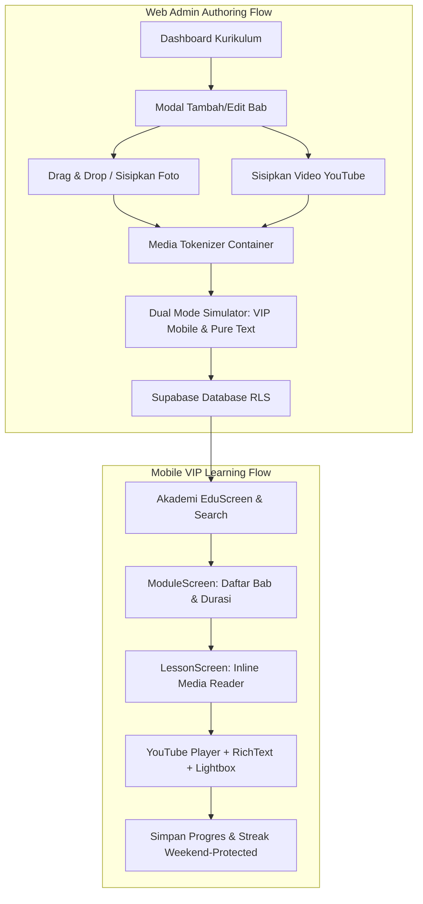

# Dokumen Audit & Refinement UI/UX: Modul Edukasi (Web Admin & Mobile App)

**Aplikasi:** PALTI FX — Ekosistem Edukasi & Jurnal Trading VIP
**Versi Analisis:** 1.0.0 (Staging)
**Tanggal Evaluasi:** 24 Oktober 2026
**Penulis:** Antigravity UI/UX Engineering

---

## 1. Ringkasan Eksekutif (Executive Summary)

Modul Edukasi PALTI FX merupakan salah satu pilar utama platform dalam mentransformasi pengguna dari trader pemula menjadi trader mandiri melalui kurikulum terstruktur. Platform ini beroperasi pada dua antarmuka utama:

1. **Web Admin (`web/src/pages/admin/AdminMateriView.tsx`)**: Pusat kendali kurikulum, authoring materi, pengelolaan media gambar/video, dan simulator tampilan mobile.
2. **Mobile App (`mobile/src/screens/EduScreens.tsx`)**: Antarmuka pembaca materi bagi member VIP di Android & iOS dengan fokus pada fokus belajar, pemutaran video terintegrasi, dan pelacakan progres.

Audit refinement ini bertujuan untuk:

- Mengevaluasi konsistensi estetika visual (**VIP Dark Minimalist**, emas `#CFA85E` / `#EDC13A`, dan bebas emotikon OS).
- Meninjau ergonomi *authoring experience* admin (pengelolaan media token, drag & drop, kompresi foto).
- Menilai pengalaman belajar (*learning experience*) member pada aplikasi mobile (rich text layout, lightbox zoom, pencarian subbab).
- Menyusun panduan paritas antarmuka serta roadmap refinement tahap selanjutnya.



---

## 2. Arsitektur Desain & Keselarasan Sistem Desain (Design System Parity)

Audit keselarasan visual antara Web Admin dan Mobile App menunjukkan konsistensi yang sangat tinggi pada hierarki warna dan aksen, dengan adaptasi ergonomis sesuai perangkat masing-masing:

| Token Desain                    | Web Admin (`web/src/index.css`)                                             | Mobile App (`mobile/src/theme.ts`)                                        | Status Paritas & Catatan UX                                                                                                                  |
| :------------------------------ | :---------------------------------------------------------------------------- | :-------------------------------------------------------------------------- | :------------------------------------------------------------------------------------------------------------------------------------------- |
| **Background Dasar**      | `--bg-deep: #07090D--bg-subtle: #0B0E15`                                    | `colors.bg: #07090Ecolors.surface: #0F0F13`                               | **Sangat Selaras**: Latar hitam pekat anti-glare, nyaman untuk membaca jangka panjang saat sesi trading malam.                         |
| **Aksen Emas Utama**      | `--gold-accent: #CFA85E--gold-hover: #DFBC77`                               | `colors.gold: #EDC13Acolors.goldLight: #FCE39A`                           | **Selaras & Terkalibrasi**: Web menggunakan tone emas champagne minimalis; Mobile menggunakan tone emas logo PALTI FX berkilau.        |
| **Warna Kartu / Surface** | `--glass-bg: rgba(255,255,255,0.035)--border-glass: rgba(255,255,255,0.08)` | `colors.card: #141419colors.border: rgba(255,255,255,0.07)`               | **Harmonis**: Web menerapkan *glassmorphism backdrop blur*; Mobile menerapkan *solid elevated card* hemat baterai OLED.            |
| **Tipografi**             | `Outfit` (Display) & `Inter` (Body)                                       | `PlusJakartaSans` (ExtraBold, Bold, SemiBold, Regular)                    | **Keterbacaan Tinggi**: Font sans-serif geometris modern dengan x-height optimal untuk naskah finansial.                               |
| **Ikonografi**            | Lucide React (`Camera`, `Layers`, `BookOpen`, `HelpCircle`, dll.)     | Ionicons Vector Icons (`camera-outline`, `play-circle`, `bulb`, dll.) | **Bebas Emotikon**: Standar *Clean Looks* diterapkan penuh; tidak ada lagi emotikon kartun OS yang menurunkan kesan profesional VIP. |

---

## 3. Evaluasi Refinement: Web Admin (`AdminMateriView.tsx`)

### 3.1. Dashboard & Hierarki Kurikulum

- **Metrik Utama (Overview Counter Cards)**: Menampilkan 4 kartu ringkasan instan di bagian atas: *Total Modul*, *Total Bab*, *Total Video YouTube*, dan *Total Foto/Media*. Memberikan visibilitas menyeluruh pada kelengkapan kurikulum.
- **Daftar Modul Berjenjang (Accordion List)**: Dilengkapi kontrol pengurutan bab (*reorder up/down*), badge tingkat kesulitan (*Pemula*, *Menengah*, *Lanjutan*), serta waktu akumulasi belajar per modul.
- **Seleksi Ikon Modul**: Menggunakan pemilih terintegrasi `IoniconsPicker` yang dilengkapi kotak panduan resmi ke direktori 1.300+ Ionicons tanpa perlu menebak nama ikon.

### 3.2. Editor Bab & Pengelolaan Media Ringkas (Authoring Experience)

Salah satu pencapaian refinement terbesar pada editor materi:

```
[SEBELUM]
Editor materi langsung dijejali string base64 foto beribu-ribu karakter dan URL video panjang.
Naskah menjadi lag, sulit di-scroll, dan admin kesulitan menemukan paragraf untuk diedit.

[SESUDAH]
Media otomatis dibungkus token representatif ringkas:
[FOTO: Setup Support & Resistance | id="img_1792829185"]
[VIDEO: Analisis Candlestick Reversal | id="vid_dQw4w9WgXcQ"]
```

#### Keunggulan Refinement Editor:

1. **Drag & Drop Foto Langsung**: Area textarea berfungsi sebagai zona *drop* file gambar. Saat file di-drag ke atas kotak, border berubah menjadi aksen emas menyala dengan instruksi visual *"Lepaskan file gambar di sini"*.
2. **Kompresi Gambar Otomatis**: Foto yang di-upload atau di-drop secara otomatis dikompresi di sisi klien via Canvas (maksimal lebar 1280px, kompresi JPEG 82%) untuk mencegah beban transfer data dan lag aplikasi.
3. **Drawer Media Tertanam (`Embedded Media Drawer`)**: Di atas naskah tersedia galeri thumbnail foto dan video yang sedang aktif dalam bab tersebut, lengkap dengan tombol *Salin Tag* dan *Hapus Media*.
4. **Fleksibilitas Posisi Bebas**: Admin bebas memilih apakah foto/video dimasukkan pada *posisi kursor aktif*, *paling atas naskah*, atau *paling bawah naskah*. Posisi token di dalam naskah menentukan letak munculnya media secara 1:1 di aplikasi mobile.
5. **Panduan Format Kolapsibel (`showNaskahGuide`)**: Menggantikan teks tip yang sebelumnya berantakan di bawah editor menjadi kartu panduan terstruktur 2 kolom:
   - *Kolom 1: Pembungkus Media Ringkas* (panduan token foto, drag & drop, penempatan naskah).
   - *Kolom 2: Format Teks Markdown* (panduan `## Subjudul`, `- Poin`, `> Catatan`, `**Tebal**`, dll.).
6. **Integritas Database Terjaga**: Saat disimpan ke Supabase, fungsi `expandMediaContent` otomatis mengekspansi token kembali ke format standar markdown `` sehingga aplikasi mobile tidak memerlukan migrasi schema database.

### 3.3. Dual-Mode Simulator & Pratinjau Bab

Admin dapat menguji tampilan naskah melalui dua mode pratinjau sebelum materi dirilis ke pengguna:

- **Mode 1: VIP Mobile Simulator**: Menampilkan bingkai simulasi fisik smartphone lengkap dengan status bar, notch kamera, navigasi antar-bab, video player terintegrasi, dan parser rich text bergaris aksen emas.
- **Mode 2: Pure Text Reader**: Mode baca bersih anti-distraksi yang merender media ke dalam kartu kontainer rapi serta menyediakan tombol *Salin Naskah Murni* (otomatis menyaring kode base64 panjang).

---

## 4. Evaluasi Refinement: Mobile App (`EduScreens.tsx`)

### 4.1. Beranda Edukasi (`EduScreen`)

- **Kartu Ring Progres Belajar**: Menampilkan cincin progres (`ProgressRing`) melingkar dengan rasio materi yang telah diselesaikan terhadap total materi kurikulum.
- **Mesin Pencari Instan Seluruh Kurikulum (`searchEduLessons`)**:
  - Mampu mencari kata kunci pada judul modul, judul bab, hingga nama subbab (`##`) dan isi paragraf.
  - Menghasilkan kartu hasil pencarian dengan badge level, durasi, indikator video, dan snippet teks yang relevan.

### 4.2. Detail Modul (`ModuleScreen`)

- **Struktur Kartu Bab**: Setiap bab disajikan dalam kartu berdesain *subtle border* dengan penomoran indeks yang jelas, estimasi durasi membaca/menonton, dan indikator ketersediaan video.
- **Feedback Progres Selesai**: Bab yang telah selesai ditandai dengan badge centang emas, memotivasi pengguna untuk menyelesaikan seluruh rangkaian modul.

### 4.3. Layar Baca Materi & Multimedia (`LessonScreen`)

- **Integrasi Video Terpusat & Inline**: Video YouTube dapat diletakkan di carousel header utama atau disisipkan langsung di sela-sela pembahasan paragraf tertentu via token `[video: url]`.
- **Parser RichText Khusus**:
  - `## Subjudul`: Diberi aksen bar vertikal emas `#E3B64F` yang tegas.
  - `- Poin`: Ditandai titik peluru emas (*gold bullet dot*) berjarak proporsional.
  - `> Catatan`: Dibungkus dalam kartu gradien emas halus dengan ikon bohlam emas elegan.
  - `Blok Kode / Istilah`: Diberi latar hitam kontras untuk membaca rumus trading (misal: *Risk:Reward Ratio*).
- **Interaksi Lightbox Foto**:
  - Foto ditampilkan dalam wadah berlekuk halus (*squircle card*) dengan keterangan gambar (*caption*).
  - Mengetuk foto akan membuka **Modal Lightbox Layar Penuh** dengan latar hitam 90% opacity, tombol tutup, dan teks caption penuh.
- **Floating Action Bar di Bawah**:
  - Tombol aksi utama *Tandai Selesai* yang langsung mencatat progres ke storage lokal per-akun (`userCacheStorage`) dan cloud Supabase.
  - Navigasi mulus ke bab berikutnya tanpa harus kembali ke menu utama.

---

## 5. Matriks Evaluasi UI/UX (Scorecard)

| Kriteria Evaluasi                     |    Skor (1-10)    | Analisis Kekuatan                                                                                                          | Area Peningkatan (Opportunities)                                                                        |
| :------------------------------------ | :----------------: | :------------------------------------------------------------------------------------------------------------------------- | :------------------------------------------------------------------------------------------------------ |
| **Estetika & Branding VIP**     | **9.6 / 10** | Latar dark pekat berpadu aksen emas proporsional; seluruh emotikon kartun telah dibersihkan; nuansa premium sangat terasa. | Tambahkan animasi transisi halus (*micro-fade*) saat berpindah antar bab di mobile.                   |
| **Ergonomi Penulisan Admin**    | **9.4 / 10** | Media token menghilangkan lag base64; drag & drop foto sangat mulus; panduan format terstruktur rapi.                      | Tambahkan pintasan keyboard (misal: `Ctrl+B` untuk tebal, `Ctrl+K` untuk subjudul).                 |
| **Keterbacaan Materi (Mobile)** | **9.5 / 10** | Tipografi `PlusJakartaSans` sangat nyaman; bar aksen emas pada subjudul memecah kebosanan teks panjang.                  | Tambahkan opsi pengaturan ukuran font (A- / A+) bagi pengguna yang membutuhkan teks lebih besar.        |
| **Performa & Anti-Lag**         | **9.7 / 10** | Kompresi gambar sisi klien, tokenisasi naskah, dan isolasi cache per-akun membuat scrolling ringan 60 FPS.                 | Pertimbangkan lazy loading untuk bab dengan lebih dari 8 gambar resolusi tinggi.                        |
| **Pencegahan Error (Safety)**   | **9.3 / 10** | Konfirmasi hapus modul/bab, dirty-state check saat membatalkan perubahan, dan konversi otomatis token media saat simpan.   | Tambahkan auto-save berkala (*draft*) di local storage browser jika koneksi admin tiba-tiba terputus. |

---

## 6. Rangkuman Refinement yang Telah Diimplementasikan

Berikut adalah daftar peningkatan konkret yang telah selesai dikerjakan dan aktif di lingkungan `staging`:

1. **Pembersihan Emotikon Total (*Clean Looks*)**:

   - Menghapus emotikon seperti kamera, pin, bohlam, dan api dari seluruh teks judul, tombol, dan panduan di Web Admin dan Mobile App.
   - Menggantikannya dengan ikon vektor formal bergaris tipis dari Lucide (`Camera`, `Layers`, `BookOpen`, `HelpCircle`) dan Ionicons.
2. **Pembungkus Media Token di Editor (`[FOTO: ...]` & `[VIDEO: ...]`)**:

   - Mencegah naskah editor dibanjiri jutaan karakter base64.
   - Editor tetap responsif, ringan di-scroll, dan teks mudah disunting.
3. **Drag & Drop Foto Langsung ke Naskah**:

   - Mendukung drag & drop file foto dari Windows Explorer / Finder langsung ke textarea editor dengan efek visual *dropzone*.
4. **Kompresi Gambar Otomatis**:

   - Otomatis memperkecil dimensi dan ukuran byte foto sebelum disisipkan ke materi.
5. **Penataan Posisi Media Kustom**:

   - Pilihan penempatan foto/video pada posisi kursor, posisi paling atas, atau posisi paling bawah.
6. **Panduan Format Kolapsibel Serasi**:

   - Tip format naskah dan media dibungkus rapi dalam kartu lipat yang serasi dengan panduan pencarian ikon.
7. **Isolasi Cache Multi-Akun & Streak Aman Akhir Pekan**:

   - Progres materi dan jurnal trading disimpan dalam ruang penyimpanan terisolasi per akun di local storage (`userCacheStorage.ts`), mencegah data tertimpa saat ganti akun.
   - Streak trading tidak terputus pada hari Sabtu dan Minggu (pasar forex libur).
8. **Branding Aplikasi 'Palti FX'**:

   - Nama aplikasi diseragamkan menjadi "Palti FX" dan dilengkapi ikon emas resmi serta konfigurasi adaptive icon Android/iOS.

---

## 7. Temuan Audit Kritis: Aspek yang "Kurang Clean" & Fitur yang "Masih Kurang"

Meskipun modul edukasi saat ini telah mencapai kualitas tinggi (~9.5/10), evaluasi forensik mendalam menemukan beberapa detail visual mikro dan fitur fungsional yang dapat disempurnakan menuju kesempurnaan (10/10):

### 7.1. Detail Visual & Mikro yang Kurang Clean (Perlu Pemolesan Segera)

|     No     | Komponen & Lokasi File                                                                 | Kondisi Saat Ini (Friction Point)                                                                                                                                                      | Rekomendasi Solusi Clean Looks                                                                                                                                   |
| :---------: | :------------------------------------------------------------------------------------- | :------------------------------------------------------------------------------------------------------------------------------------------------------------------------------------- | :--------------------------------------------------------------------------------------------------------------------------------------------------------------- |
| **1** | **Toolbar Quick Format Naskah**`web/.../AdminMateriView.tsx:2513`              | Tombol format poin menggunakan karakter mentah `• List`.                                                                                                                            | Ganti karakter bullet mentah dengan ikon SVG Lucide `<List size={13} />` atau teks bersih `Poin` agar serasi dengan tombol `H2` dan `Tips`.              |
| **2** | **Tombol Panduan Pemilih Ikon**`web/.../IoniconsPicker.tsx:199`                | Menggunakan karakter teks mentah panah miring: `Panduan Cari Ikon ↗`.                                                                                                               | Ganti panah teks mentah dengan ikon SVG Lucide `<ExternalLink size={12} />` agar sejalan dengan standar tombol tautan resmi lainnya.                           |
| **3** | **Label Kontainer Video di Mode Teks Murni**`web/.../AdminMateriView.tsx:3295` | Kartu kontainer video di *Pure Text Mode* menampilkan string mentah: `Container Video: [video: https://youtu.be/... \| id="..."]`.                                                  | Bersihkan string token dan tampilkan judul/ID yang rapi, contoh: `Video YouTube (ID: dQw4w9WgXcQ)` tanpa membocorkan sintaks kurung siku.                      |
| **4** | **Tinggi Kontainer Foto di Mobile**`mobile/.../EduScreens.tsx:1152`            | Foto menggunakan tinggi tetap `height: 230` dengan `resizeMode: "contain"`. Foto vertikal atau grafik 16:9 yang sangat lebar menyisakan ruang hitam (*letterbox*) di kiri/kanan. | Terapkan batas tinggi adaptif (`minHeight: 180, maxHeight: 280`) atau hitung rasio aspek responsif agar gambar menyatu mulus tanpa rongga hitam yang canggung. |

### 7.2. Fitur UX & Keamanan Penulisan yang Masih Kurang

1. **Auto-Calculate Estimasi Menit Baca (Web Admin)**:

   - **Isu**: Admin harus mengklik chevron atau menebak angka menit secara manual di kolom *Estimasi Waktu*.
   - **Solusi UX**: Tambahkan kalkulasi otomatis pintar *(misal: 150–200 kata = 1 menit)* dengan tombol kecil *"Hitung Otomatis"* di samping input durasi.
2. **Auto-Save Draft ke LocalStorage Browser (Web Admin Safeguard)**:

   - **Isu**: Apabila admin sedang menyusun materi silabus panjang dan terjadi gangguan listrik, koneksi putus, atau tab browser tertutup mendadak sebelum menekan tombol *Simpan Bab*, naskah yang belum disimpan bisa lenyap.
   - **Solusi UX**: Terapkan mekanisme *Silent Auto-Draft* ke `localStorage` browser per `moduleId + lessonId` setiap 5–10 detik dengan notifikasi status pemulihan (*draft restored*) saat modal dibuka kembali.
3. **Micro-Celebration saat Menyelesaikan Bab/Modul (Mobile VIP)**:

   - **Isu**: Saat pengguna menekan *"Selesai & Lanjut"*, aplikasi langsung berpindah layar secara instan tanpa ada feedback kepuasan visual.
   - **Solusi UX**: Tambahkan animasi mikro selebrasi halus (misal: getaran haptic berirama, centang emas mekar sesaat, atau partikel emas lembut) untuk memberikan dorongan dopamin atas pencapaian materi trading.

---

## 8. Roadmap & Rekomendasi Refinement Tahap Lanjutan

Seluruh temuan pada Bagian 7 telah ditindaklanjuti dan diverifikasi dengan type-check web dan mobile serta seluruh tes mobile. Berikut status rencana aksi bertahap:

### Prioritas 1 (Quick Wins - Pemolesan Visual & UX Safety) - Selesai

- [x] **Pembersihan Simbol Mentah Toolbar**: tombol `• List` kini memakai ikon `<List />` dengan label `Poin` di [AdminMateriView.tsx](file:///c:/Work/palti-fx/palti-fx/web/src/pages/admin/AdminMateriView.tsx).
- [x] **Pembersihan Panah Mentah Pemilih Ikon**: karakter panah dihapus dari label tombol di [IoniconsPicker.tsx](file:///c:/Work/palti-fx/palti-fx/web/src/components/admin/IoniconsPicker.tsx). Ikon `<ExternalLink />` sengaja tidak dipakai karena tombol ini membuka panel panduan di dalam halaman, bukan tautan keluar.
- [x] **Penyempurnaan Label Pure Text**: kartu media pada mode teks murni kini menampilkan `Video: <ID YouTube>` dan `Foto: <caption>`, tanpa sintaks token mentah.
- [x] **Penyimpanan Draft Otomatis (`localStorage`)**: naskah, judul, durasi, dan daftar media disimpan 3 detik setelah ketikan terakhir, hanya bila berbeda dari kondisi awal. Saat modal dibuka kembali muncul banner **Pulihkan Draft** atau **Buang**. Draft dihapus otomatis setelah bab berhasil disimpan, dan status penyimpanan tampil di footer modal.
- [x] **Kalkulasi Estimasi Waktu Baca Otomatis**: tombol **Hitung otomatis (N menit)** di bawah kolom durasi, dihitung dari jumlah kata dengan kecepatan 200 kata per menit. Token media dan tautan tidak dihitung.

### Prioritas 2 (Medium Term - Peningkatan Keterlibatan Pembelajaran)

- [x] **Rasio Foto Dinamis di Mobile**: komponen `AdaptiveImage` di [EduScreens.tsx](file:///c:/Work/palti-fx/palti-fx/mobile/src/screens/EduScreens.tsx) membaca ukuran asli gambar. Rasio dibatasi 1:1 sampai 2:1 sehingga foto tegak tidak terlalu tinggi dan foto lebar tidak terlalu pipih.
- [x] **Animasi Mikro Selesai Bab**: komponen `CompletionPulse` di [motion.tsx](file:///c:/Work/palti-fx/palti-fx/mobile/src/components/motion.tsx) menampilkan centang emas singkat (sekitar 0,6 detik) disertai haptic sebelum berpindah layar. Hanya muncul saat bab belum berstatus selesai.
- [ ] **Bookmark / Simpan Subbab**: mengizinkan member menandai subbab atau grafik chart tertentu untuk dipelajari kembali.
- [ ] **Kuis Singkat Pemahaman Bab**: mini-kuis 3 pertanyaan pilihan ganda sebelum bab dapat ditandai selesai 100%.
- [ ] **Catatan Pribadi Member**: tab catatan pribadi di bawah materi bagi member untuk mencatat trading plan mereka.

### Prioritas 3 (Long Term - Pengalaman VIP Eksklusif)

- [ ] **Offline Reader Mode**: kemampuan mengunduh modul teks dan foto terpilih untuk dibaca tanpa jaringan internet.
- [ ] **Audio Narasi / Voiceover**: pemutar audio narasi materi bagi member yang ingin mendengarkan rangkuman materi.

---

*Dokumen audit ini telah diverifikasi dan siap dijadikan acuan implementasi pengembangan berkelanjutan bagi tim engineering PALTI FX.*
